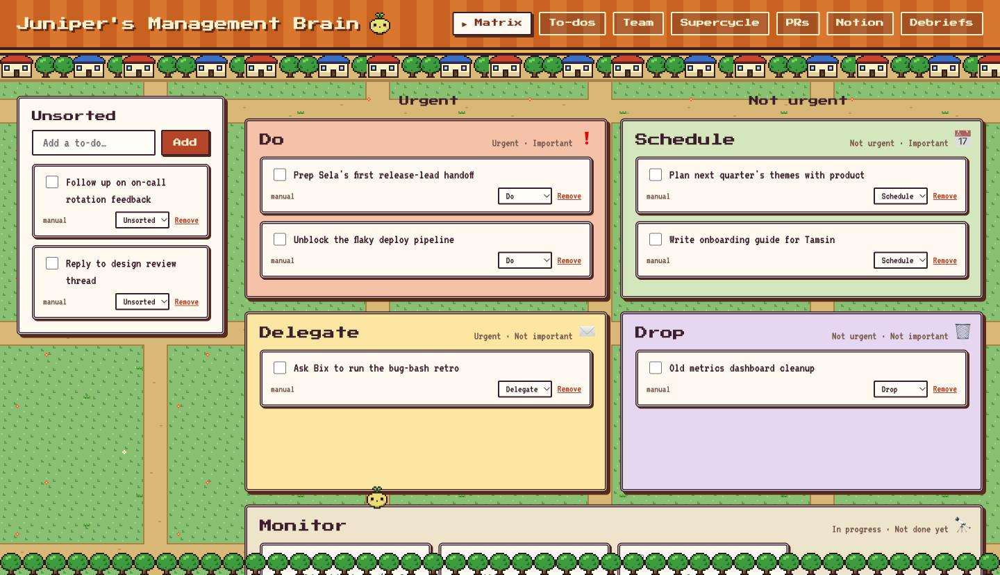
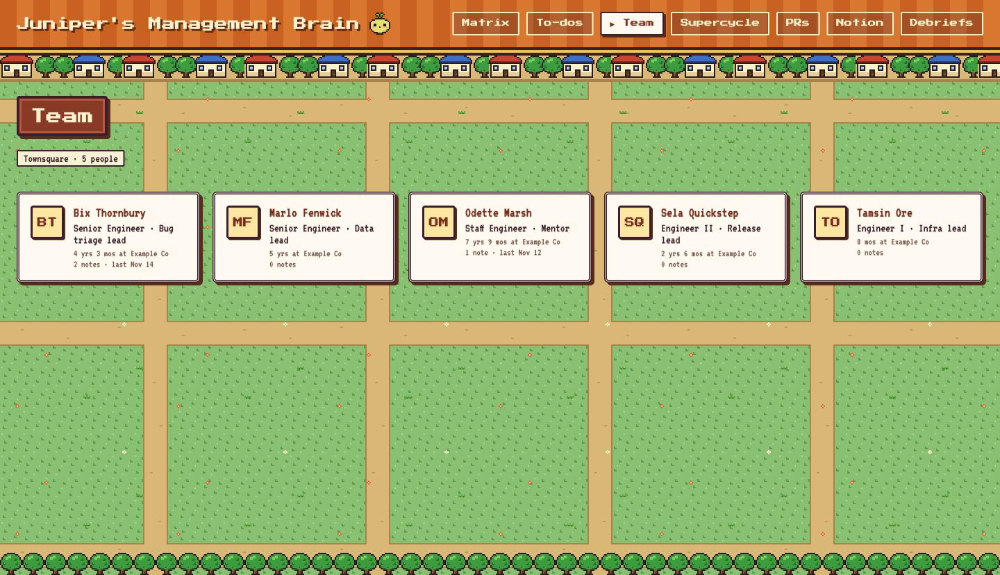
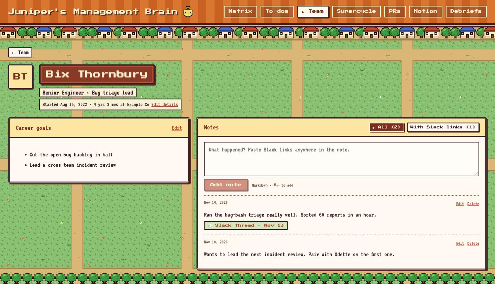
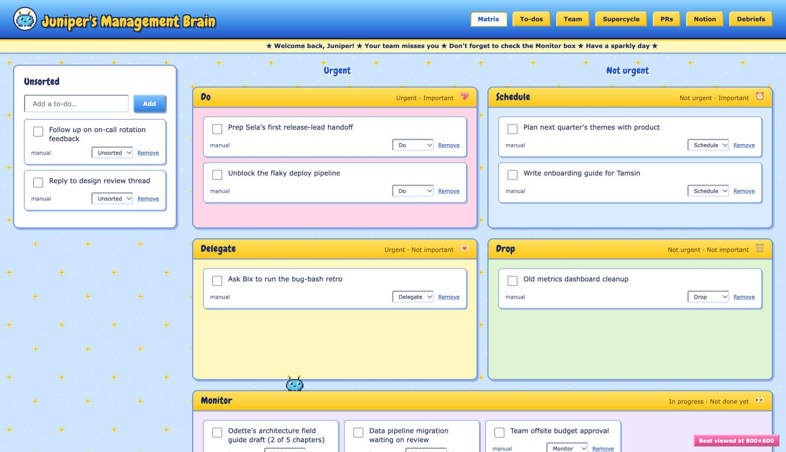
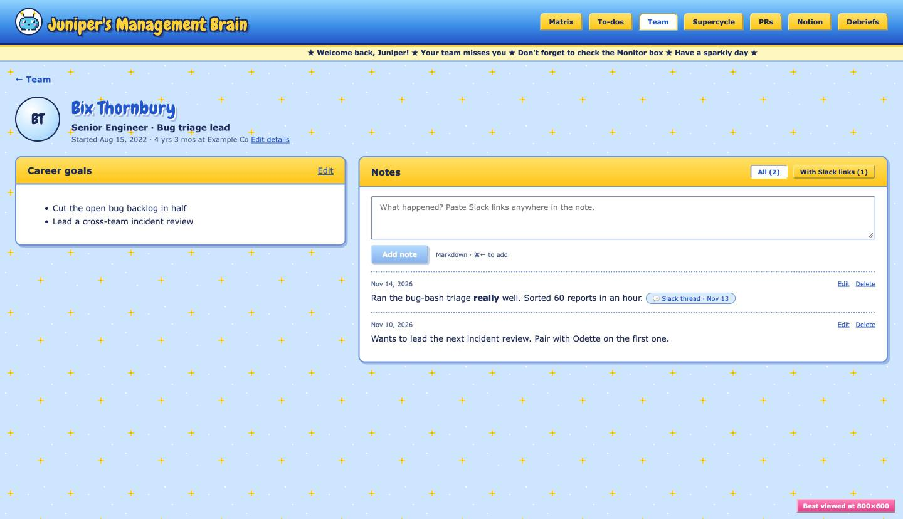
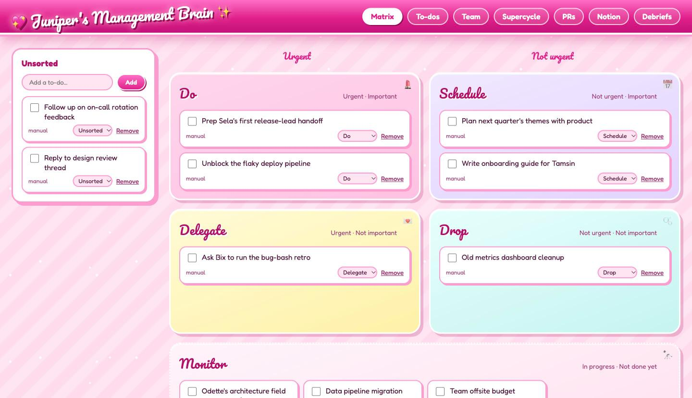
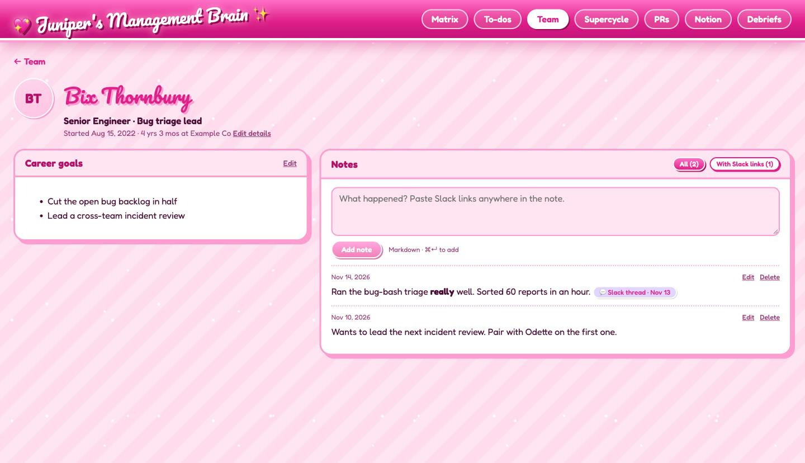

# Engineering Management

Claude Code skills for engineering managers.

## management-brain-starter

Sets up a personal "management brain": a local React app for running a team, plus the Claude
skills that keep it filled in.



- **Matrix:** an Eisenhower matrix of your commitments, with a **Monitor** box for things in progress.
- **Team:** a page per report with their title, time at the company, career goals, and notes with Slack links.
- **Notion:** your Notion notifications, rebuilt from Notion's emails in Superhuman.
- **Supercycle and PRs:** Linear projects and their pull requests.
- **Debriefs:** daily debriefs from your calendar, Obsidian notes, Slack, Linear, GitHub and Notion.

The skill interviews you for your team, Slack channels, Notion pages and Obsidian vault, then lays
out the app and installs its helper skills (`daily-debrief`, `refresh-notion-inbox`). Nothing it
sets up sends messages or changes anything in your connected tools.

### Install

```bash
git clone https://github.com/tehfedaykin/EngineeringManagement.git
cp -R EngineeringManagement/skills/management-brain-starter ~/.claude/skills/
```

Then ask Claude Code to "set up my management brain".

You'll need Node 20+ and Yarn. Each screen uses a claude.ai connector (Slack, Notion, Linear,
Superhuman, Google Calendar); the skill turns off screens for connectors you don't have.

### Themes

The setup interview shows these side by side so you can pick one.

**`golden-city`** (default): a pixel town with grass, dirt paths, little houses, brick shop-sign titles and a sprout mascot. All original pixel art, drawn by `pixel_art.py`.

| | |
|---|---|
|  |  |

**`y2k-petsite`**: an early-2000s virtual-pet site. Pastel sparkle tiles, a bubbly title, yellow beveled buttons, a scrolling welcome ticker, a "best viewed at 800×600" badge and Pip, an original pixel pet.

| | |
|---|---|
|  |  |

**`bubblegum`**: a 90s pink toy-ad look with script titles, glossy pills and sparkles.

| | |
|---|---|
|  |  |

The people in the screenshots are made up.

### Credits

The daily-debrief skill is adapted from
[jasminelsjames/leading-deeper-ai-skills](https://github.com/jasminelsjames/leading-deeper-ai-skills).
